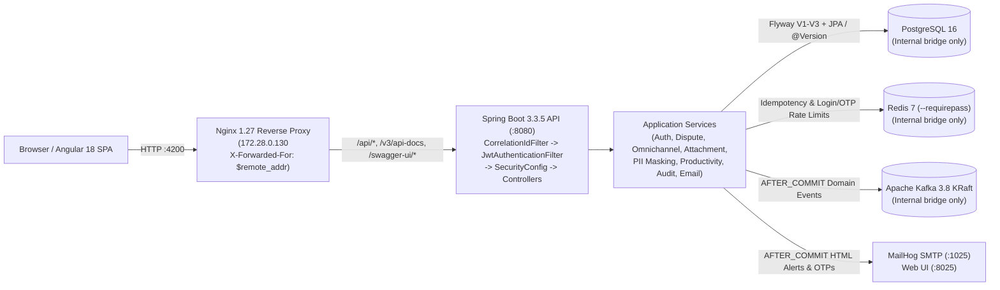

# Cap Trans Dsp Ptl

Full-stack transaction dispute management application built with **Java 21**, **Spring Boot 3.3.5**, **PostgreSQL 16**, **Redis 7**, **Apache Kafka 3.8**, and **Angular 18**.

Customers can view settled account transactions across payment rails (`CARD_POS`, `ONLINE_ECOMMERCE`, `PAYSHAP`, `DEBIT_ORDER`), submit disputes with supporting evidence, filter active vs. historic disputed transactions, and re-open rejected claims with full case lineage. Internal staff, external clearing partners, and admins handle investigation, escalation, PII-masked delegation, auditing, and turnaround reporting.

---

## System Architecture



### Verified Codebase Components

- **Presentation Layer (`za.co.capi.dispute.presentation`):**
  - Controllers: `AuthController`, `TransactionController`, `DisputeController`, `OmnichannelController`, `AdminController`
  - DTOs & Exception Handling: `ApiDtos`, `ApiException`, `GlobalExceptionHandler`
- **Application Services (`za.co.capi.dispute.application.service`):**
  - `AuthService`, `TransactionService`, `DisputeService`, `OmnichannelDisputeService`, `AttachmentStorageService`, `PiiMaskingService`, `ProductivityService`, `AuditService`, `NotificationEmailService`
- **Domain Model & Policies (`za.co.capi.dispute.domain`):**
  - Entities & Enums: `AppUser`, `BankTransaction`, `Dispute` (with `@Version`), `DisputeAttachment`, `DisputeNote`, `FraudAlertToken`, `PasswordResetOtp`, `StaffWorkSession`, `AuditLog`, `DisputeCategory`, `DisputeChannel`, `DisputeStatus`, `TransactionStatus`, `UserDomain`, `UserRole`
  - State Machine Policy: `DisputeTransitionPolicy`
  - Repositories: `AppUserRepository`, `AuditLogRepository`, `BankTransactionRepository`, `DisputeAttachmentRepository`, `DisputeNoteRepository`, `DisputeRepository`, `FraudAlertTokenRepository`, `PasswordResetOtpRepository`, `StaffWorkSessionRepository`
- **Infrastructure (`za.co.capi.dispute.infrastructure`):**
  - Security & Request Context: `SecurityConfig`, `JwtAuthenticationFilter`, `JwtTokenProvider`, `AppUserPrincipal`, `ClientIpResolver`, `CorrelationIdFilter`
  - Cache & Rate Limiting: `IdempotencyLockService`, `LoginRateLimiterService`, `OtpRateLimiterService`
  - Messaging & Config: `KafkaEventService`, `KafkaTopicConfig`, `DataSeeder`, `OpenApiConfig`
- **Frontend (`frontend/src/app`):**
  - Core: `AuthService`, `PortalApiService`, `authGuard`, `roleGuard`, `authInterceptor`, `portal.models.ts`
  - Feature Components: `login`, `fraud-report`, `reset-password-verify`, `customer`, `staff`, `affiliate`, `admin`, `dispute-detail`, `omnichannel`

---

## Project Layout

```text
transactions_dispute_portal/
├── .env.example              # Template environment variables for local Docker Compose runs
├── .github/workflows/ci.yml  # GitHub Actions CI (backend tests, Angular tests & build, Compose check)
├── docker-compose.yml        # PostgreSQL, Redis, Kafka (KRaft), MailHog, Backend, Frontend
├── scripts/smoke.sh          # End-to-end API & UI smoke verification script
├── backend/
│   ├── Dockerfile            # Multi-stage Maven build + JUnit tests -> JRE 21 Alpine
│   ├── pom.xml
│   └── src/
│       ├── main/java/za/co/capi/dispute/
│       │   ├── domain/           # JPA entities, enums, DisputeTransitionPolicy & repositories
│       │   ├── application/      # Auth, Dispute, Omnichannel, Attachment, PII Masking, Productivity, Audit, Email
│       │   ├── infrastructure/   # JWT/CORS/Proxy/Correlation security, Redis locks & rate limiters, Kafka, DataSeeder
│       │   └── presentation/     # REST controllers, validated DTOs, GlobalExceptionHandler
│       ├── main/resources/db/migration/ # Flyway migrations: common (V1, V3) + postgresql (V2)
│       └── test/java/za/co/capi/dispute/ # 22 JUnit 5 test classes (65 test executions)
└── frontend/
    ├── Dockerfile            # Multi-stage Node 22 (`npm ci --legacy-peer-deps`) build -> Nginx 1.27 Alpine
    ├── nginx.conf            # SPA routing + reverse proxy to backend:8080 (`X-Forwarded-For: $remote_addr`)
    ├── package-lock.json     # Locked frontend dependencies
    └── src/app/
        ├── core/             # AuthService, PortalApiService, authInterceptor, authGuard/roleGuard + 4 *.spec.ts suites (12 specs)
        └── features/         # Login, Fraud Report, OTP Reset, Customer, Staff, Affiliate, Admin, Dispute Detail, Simulator
```

---

## Key Features

- **Customer Transactions & Historic Dispute View:** View settled transactions with inline dispute status badges and filter logged disputes by `All`, `Active`, or `Historic / Closed` (`RESOLVED`, `REFUNDED`, `REJECTED`).
- **Dispute Lifecycle & Optimistic Concurrency Control:** State machine enforced centrally by `DisputeTransitionPolicy` across `LOGGED`, `IN_REVIEW`, `PENDING_CUSTOMER_ACTION`, `PENDING_EXTERNAL_REVIEW`, `ESCALATED`, and immutable terminal states (`RESOLVED`, `REFUNDED`, `REJECTED`). `Dispute` uses `@Version` (`V3` migration) so concurrent `/claim` or transition requests return `409 Conflict` instead of double-claiming. Rejected disputes can be re-opened with an `original_dispute_id` lineage link.
- **Multi-File Evidence Uploads:** Supports up to 5 files per dispute (`PDF`, `PNG`, `JPG`, max 5 MB each) with magic-byte validation, `nosniff` download headers, and SHA-256 checksums stored per attachment. Uploads and notes are blocked once a dispute reaches a terminal state.
- **IDOR Prevention & Immutable Audit Trail:** Cross-customer or unauthorized cross-domain access attempts fail with `403 Forbidden` and persist a `UNAUTHORIZED_ACCESS_ATTEMPT` audit record via `AuditService` (`PROPAGATION_REQUIRES_NEW`), exportable as sanitized CSV.
- **POPIA Partner PII Masking:** Disputes delegated to `PARTNER_BANKSERV` or `PARTNER_MERCHANT` automatically mask customer PII (`SA ID`, `phone`, `account number`, `email`, `fullName`) and redact phone, SA ID, and account identifiers inside free-text fields (`reason`, notes, `contactChannelMetadata`) for `AFFILIATE` callers.
- **Brute-Force Protection, Fraud Lockdown & OTP Recovery:** `LoginRateLimiterService` locks an account for 15 minutes (`900s`) after 5 consecutive failures and returns `429 Too Many Requests` after 20 failures per IP in 5 minutes (`300s`). `AuthService` returns uniform `401 Unauthorized` payloads and equalized BCrypt timing across unknown, locked, and wrong-password attempts, and resets counters on success. Customer logins email a one-click fraud alert (`It Wasn't Me`) that revokes active JWTs via `tokenVersion` and emails a cryptographic 6-digit OTP (never in email subjects or logs).
- **Redis Idempotency Locking:** `POST /api/v1/disputes` uses atomic Redis `SET NX EX` locks via `IdempotencyLockService` to prevent duplicate submissions on retries (`409 Conflict`).
- **After-Commit Kafka & Email Delivery:** `KafkaEventService` and `NotificationEmailService` dispatch events and HTML-escaped emails via `@TransactionalEventListener(phase = TransactionPhase.AFTER_COMMIT, fallbackExecution = true)` so rolled-back transactions never leak side effects, with bounded 5-second SMTP timeouts.
- **Strict Omnichannel SMS / WhatsApp / Voice Simulator:** Interactive simulator at `/simulator` validates registered customer phone numbers and transaction references (`transactionId` or `TXN-YYYY-XXXX`), returning `400 Bad Request` when missing and keeping channel intake notes internal (`internalOnly = true`) without storing raw phone numbers in metadata or note bodies.
- **SQL-Aggregated Staff Productivity Tracking:** `ProductivityService` and `StaffWorkSessionRepository` aggregate investigator work sessions directly in SQL and fetch attachment counts in a single grouped query (`DisputeAttachmentRepository`).

---

## Pre-Seeded Demo Accounts (`demo` profile)

When `SPRING_PROFILES_ACTIVE=demo` (enabled in `.env.example` for quick local evaluation), `DataSeeder` seeds 5 users (all with password `Password123!`), 6 sample transactions, 1 active PayShap dispute (`DSP-2026-10042`), and 1 historic refunded dispute (`DSP-2026-09811`):

| Email | Role | Domain |
| :--- | :--- | :--- |
| `customer@capi.test` | `CUSTOMER` | `CUSTOMER` |
| `customer2@capi.test` | `CUSTOMER` | `CUSTOMER` |
| `staff@capi.test` | `STAFF` | `INTERNAL_CAPI` |
| `affiliate@bankserv.test` | `AFFILIATE` | `PARTNER_BANKSERV` |
| `admin@capi.test` | `ADMIN` | `INTERNAL_CAPI` |

---

## Building & Running

### Prerequisites
- Docker & Docker Compose v2+
- *(Optional for local runs)* Java 21, Node.js 22 (backend includes Maven Wrapper `./mvnw`)

### Run Full Stack with Docker Compose

1. Create a local `.env` file from `.env.example` (never commit `.env`):
   ```bash
   cp .env.example .env
   ```
   > **Note:** `docker-compose.yml` leaves `SPRING_PROFILES_ACTIVE` empty by default so no demo accounts are seeded unless explicitly requested. `.env.example` sets `SPRING_PROFILES_ACTIVE=demo` for convenient reviewer walkthroughs; remove or blank it out in `.env` for a clean non-demo startup.

2. Start all containers:
   ```bash
   docker compose up -d --build
   ```

3. Check container health:
   ```bash
   docker compose ps
   ```

Host-exposed services:
- **Frontend UI (Nginx reverse proxy):** http://localhost:4200
- **Backend API:** http://localhost:8080 (`http://localhost:8080/actuator/health`)
- **Swagger UI (OpenAPI):** http://localhost:8080/swagger-ui.html (also proxied at http://localhost:4200/swagger-ui/index.html)
- **OpenAPI JSON Spec:** http://localhost:8080/v3/api-docs
- **MailHog Web UI / SMTP:** http://localhost:8025 (SMTP port `1025`)

Internal-only Docker bridge services (not published to host ports; authenticated from `.env` on `172.28.0.0/24`):
- **PostgreSQL 16 (`postgres:16-alpine`):** internal hostname `postgres:5432`
- **Redis 7 (`redis:7-alpine` with `--requirepass`):** internal hostname `redis:6379`
- **Apache Kafka 3.8 KRaft (`apache/kafka:3.8.0`):** internal hostname `kafka:9092`

To stop containers and clear database/attachment volumes:

```bash
docker compose down -v
```

### Run Locally Without Full Docker

1. Create `.env` (`cp .env.example .env`) and start infrastructure services:
   ```bash
   docker compose up -d postgres redis kafka mailhog
   ```
2. Start backend (using internal/local overrides or H2 `demo` profile):
   ```bash
   cd backend
   ./mvnw spring-boot:run
   ```
3. Start frontend:
   ```bash
   cd frontend
   npm ci --legacy-peer-deps
   npm start
   ```

---

## Testing & Verification

### Automated Backend Tests (22 JUnit 5 Classes, 65 Test Executions)

The backend test suite runs automatically during Docker image builds or locally via Maven Wrapper:

```bash
cd backend
./mvnw test -B
```

Test suite breakdown across all **22** classes:
- **End-to-End Lifecycle & Focus Tests:** `DisputePortalIntegrationTest` (5 focused tests covering multipart disputes, idempotency, IDOR, fraud/OTP reset, claim/reply/escalation/delegation/reopen, admin/Kafka/OpenAPI, omnichannel SMS & voice), `DisputeAuthorizationAndTransitionTest` (5 focused role, domain, transition, and assignment tests), `TransactionIntegrityTest` (2 tests), `PaginationAndQueryOptimizationTest` (1 test)
- **Security, Authentication & Proxy Trust:** `OtpSecurityTest` (5 tests including log/subject redaction via `CapturedOutput` and HTML escaping), `LoginBruteForceAndLockoutTest` (4 tests covering 5-failure account lock, 20-failure/5-minute IP `429`, counter reset, and uniform timing/401), `FraudRecoveryConfirmationTest` (1 test), `CorsAndProxyTrustTest` (4 tests including right-most untrusted `X-Forwarded-For` resolution), `JwtSecretValidationTest` (3 tests), `AttachmentSecurityTest` (1 test), `AuditCsvSanitizationTest` (2 tests)
- **Validation, Concurrency, Errors, Masking & Omnichannel:** `DisputeValidationParameterizedTest` (10 parameterized executions across JSON and multipart endpoints), `DisputeConcurrentClaimTest` (1 multi-threaded `CountDownLatch` claim race test), `GlobalExceptionHandlerTest` (2 tests covering sanitized 400 responses, 500 `traceId`, and full stack-trace logging), `DisputeTransitionPolicyTest` (9 tests covering every source row in the transition matrix plus role/null guards), `PiiMaskingServiceTest` (2 tests including free-text identifier masking), `OmnichannelAndAffiliatePiiTest` (2 tests)
- **Profile Gating, Kafka & Schema Migrations:** `DataSeederWithDemoProfileTest` (1 test), `DataSeederWithoutDemoProfileTest` (1 test), `KafkaEventServiceTest` (2 tests), `FlywayMigrationAndConstraintTest` (1 H2 migration test), `PostgresMigrationTestcontainersTest` (1 `@Testcontainers(disabledWithoutDocker = true)` test executing `V1`, `V2`, `V3` against `postgres:16-alpine` when Docker is running)

### Automated Frontend Tests (4 Jasmine/Karma Spec Files, 12 Specs)

```bash
cd frontend
npm ci --legacy-peer-deps
NG_CLI_ANALYTICS=false npm test
```

Covers `AuthService` (`auth.service.spec.ts`), `PortalApiService` (`portal-api.service.spec.ts`), `authGuard` / `roleGuard` (`auth.guard.spec.ts`), and `authInterceptor` (`auth.interceptor.spec.ts`) in headless Chrome (`12` specs total).

### End-to-End Smoke Verification & CI

After bringing up the Docker Compose stack (`cp .env.example .env && docker compose up -d --build`), run:

```bash
./scripts/smoke.sh
```

GitHub Actions CI ([.github/workflows/ci.yml](.github/workflows/ci.yml)) runs the backend Maven tests, frontend Karma unit tests + production build, and `docker compose --env-file .env.example config -q` on pushes and pull requests to `main`.

---

## Main API Endpoints

| Method & Path | Access | Purpose |
| :--- | :--- | :--- |
| `POST /api/v1/auth/login` | Public | Authenticate user and issue JWT (brute-force protected; triggers customer login alert email) |
| `GET /api/v1/auth/report-fraud/preview?token=...` | Public | Validate fraud alert token and preview masked email before locking |
| `GET /api/v1/auth/report-fraud?token=...` | Public | Read-only browser redirect (`302`) to frontend fraud confirmation page |
| `POST /api/v1/auth/report-fraud?token=...` | Public | Lock account, revoke active JWTs, log audit, email 6-digit OTP after commit |
| `POST /api/v1/auth/reset-password-verify` | Public | Verify 6-digit OTP, update password, unlock account |
| `GET /api/v1/transactions` | `CUSTOMER` | List authenticated customer's transactions |
| `GET /api/v1/disputes` | Authenticated | List paginated disputes (`page`, `size`, optional `status`) scoped by role/domain |
| `POST /api/v1/disputes` | `CUSTOMER` | Create dispute (JSON or `multipart/form-data`, Redis idempotency locked, unified validation) |
| `GET /api/v1/disputes/{id}` | Authenticated | Get dispute details, notes, attachments, and lineage (POPIA masked for affiliates) |
| `POST /api/v1/disputes/{id}/attachments` | `CUSTOMER`, `STAFF`, `ADMIN` | Upload additional evidence files (blocked in terminal states) |
| `GET /api/v1/disputes/{id}/attachments/{attachmentId}` | Authenticated | Download evidence attachment (`X-Content-Type-Options: nosniff`) |
| `POST /api/v1/disputes/{id}/claim` | `STAFF`, `ADMIN` | Claim dispute (`IN_REVIEW`) with `@Version` optimistic lock and start work session timer |
| `POST /api/v1/disputes/{id}/notes` | Authenticated | Add note (`requiresCustomerReply` transitions via `DisputeTransitionPolicy`) |
| `POST /api/v1/disputes/{id}/escalate` | `CUSTOMER`, `STAFF`, `ADMIN` | Escalate dispute to supervisor queue |
| `POST /api/v1/disputes/{id}/delegate` | `STAFF`, `ADMIN` | Delegate dispute to `PARTNER_BANKSERV` or `PARTNER_MERCHANT` |
| `PATCH /api/v1/disputes/{id}/status` | `STAFF`, `ADMIN` | Transition dispute status |
| `POST /api/v1/disputes/{id}/reopen` | `CUSTOMER` | Re-open a `REJECTED` dispute as a linked case |
| `GET /api/v1/admin/audit-logs` | `ADMIN` | View paginated audit logs (`page`, `size`, optional `eventType`) |
| `GET /api/v1/admin/audit-logs/export` | `ADMIN` | Export audit logs as CSV (bounded to 10,000 most recent rows) |
| `GET /api/v1/admin/reports/productivity` | `ADMIN` | View SQL-aggregated investigator turnaround metrics |
| `GET /api/v1/admin/events/kafka-stream` | `ADMIN` | Inspect Kafka topics/events and Redis lock status |
| `POST /api/v1/admin/users/{id}/unlock` | `ADMIN` | Unlock a locked user account |
| `POST /api/v1/admin/disputes/{id}/assign` | `ADMIN` | Assign/reassign dispute to investigator or partner domain |
| `POST /api/v1/omnichannel/sms-webhook` | Authenticated | Simulate inbound SMS/WhatsApp dispute intake (strict phone + transaction required) |
| `POST /api/v1/omnichannel/voice-call` | Authenticated | Simulate Call Centre / IVR voice call dispute intake (strict phone + transaction required) |

---

## Dispute Status Transition Policy

Enforced centrally in `DisputeTransitionPolicy` and routed there for all status mutations in `DisputeService` (including `addNote(..., requiresCustomerReply = true)`):

| Current Status | Allowed Next Statuses |
| :--- | :--- |
| `LOGGED` | `IN_REVIEW`, `PENDING_CUSTOMER_ACTION`, `PENDING_EXTERNAL_REVIEW`, `ESCALATED`, `REJECTED` |
| `IN_REVIEW` | `PENDING_CUSTOMER_ACTION`, `PENDING_EXTERNAL_REVIEW`, `ESCALATED`, `RESOLVED`, `REFUNDED`, `REJECTED` |
| `PENDING_CUSTOMER_ACTION` | `IN_REVIEW`, `ESCALATED`, `RESOLVED`, `REFUNDED`, `REJECTED` |
| `PENDING_EXTERNAL_REVIEW` | `IN_REVIEW`, `ESCALATED`, `RESOLVED`, `REFUNDED`, `REJECTED` |
| `ESCALATED` | `IN_REVIEW`, `PENDING_CUSTOMER_ACTION`, `PENDING_EXTERNAL_REVIEW`, `RESOLVED`, `REFUNDED`, `REJECTED` |
| `RESOLVED`, `REFUNDED`, `REJECTED` | Terminal — no transitions permitted (`REJECTED` may be re-opened as a new linked `LOGGED` dispute by the owning `CUSTOMER`) |

- **Role boundaries:** Only `STAFF` and `ADMIN` can invoke `/status`, `/claim`, or `/delegate`. `CUSTOMER` users can escalate their own disputes (`ESCALATED`), reply to `PENDING_CUSTOMER_ACTION` notes (returning to `IN_REVIEW`), upload evidence, and re-open `REJECTED` disputes. `AFFILIATE` users can only read disputes assigned to their partner domain (with PII and free-text identifiers masked) and add non-internal notes.
- **Admin assignment validation:** `POST /api/v1/admin/disputes/{id}/assign` rejects `CUSTOMER` as a target domain and requires any `assigneeUserId` to be unlocked and domain/role compatible (`STAFF`/`ADMIN` in `INTERNAL_CAPI` or `AFFILIATE` in the matching partner domain).

---

## Transaction Integrity & Input Validation Rules

- **Unified creation validation (JSON & Multipart):** Both JSON and `multipart/form-data` `POST /api/v1/disputes` paths normalize and validate via `@Valid` + `DisputeService.createDisputeWithChannel`: `reason` is trimmed and must be `5`–`2000` characters, `amount` must be between `0.01` and `9999999.99` with at most `2` decimal places (`@Digits(integer = 7, fraction = 2)`), and PostgreSQL/H2 enforces `CHECK (amount > 0)` via `V3__dispute_version_amount_check_and_seq.sql`.
- **Transaction-backed disputes (`transactionId` supplied):**
  - Verifies the authenticated customer owns the referenced `BankTransaction` (`403 Forbidden` otherwise).
  - Requires `BankTransaction.status == SETTLED` (`409 Conflict` for `PENDING` or `REVERSED` transactions).
  - Prevents duplicate active disputes on the same `transactionId` (`409 Conflict` while a non-terminal dispute exists; `REJECTED` cases can still be re-opened).
  - Derives `merchantName`, `paymentRail`, and `amount` authoritatively from `BankTransaction`, ignoring any tampered client-supplied values.
- **Strict omnichannel validation (`OmnichannelDisputeService`):** SMS/WhatsApp and Voice intakes require a valid registered customer phone number AND an explicit transaction match (`transactionId` UUID or `TXN-YYYY-XXXX` reference in the message/transcript), returning `400 Bad Request` otherwise. No demo email, R500 default amount, or automatic latest-transaction fallback is used.

---

## Assumptions & Known Limitations

- **Stateless JWT & Temporary Lockout Interaction:** Access tokens are stateless HMAC-SHA256 JWTs (`28800s` / 8-hour default TTL). `JwtAuthenticationFilter` verifies `!user.isLocked()` and `user.getTokenVersion()` on each API request so fraud lockdowns revoke active tokens immediately, whereas `LoginRateLimiterService` temporary lockouts (5 consecutive wrong passwords = `900s` lockout) apply specifically to new `/api/v1/auth/login` attempts.
- **Rate Limiter Storage Fallback:** `LoginRateLimiterService` and `OtpRateLimiterService` use Redis atomic counters when Redis is reachable and fall back to bounded in-memory sliding windows (`ConcurrentHashMap`) if Redis is disabled or unavailable (for example, in the H2 unit/integration test profile). Multi-instance horizontal scaling in production assumes shared Redis availability.
- **Local Attachment Storage & AV Scanning Trade-Off:** `AttachmentStorageService` persists evidence files on local/Docker volume storage (`/app/storage/attachments`) after verifying magic bytes (`%PDF-`, PNG, JPEG), extension/`Content-Type` consistency, 5 MB file size, and 5-file cap, with `TransactionSynchronization` rollback cleanup. External antivirus/ICAP scanning and cloud object storage (S3/GCS) are deferred to keep deployment self-contained.
- **Best-Effort After-Commit Events (`BEST_EFFORT_AT_MOST_ONCE`):** `KafkaEventService` and `NotificationEmailService` execute after database commit via `@TransactionalEventListener(phase = TransactionPhase.AFTER_COMMIT, fallbackExecution = true)`. A persistent transactional outbox table would be required for guaranteed at-least-once delivery across sudden process crashes immediately after commit.
- **JPA-Level Audit Immutability:** `AuditLog` is append-only at the JPA layer (`@Immutable` and `updatable = false` columns) and CSV exports neutralize spreadsheet formula prefixes (`=`, `+`, `-`, `@`, `\t`, `\r`) within a 10,000-row cap. Hardening a shared production DB requires revoking `UPDATE`/`DELETE` grants from the application DB role.
- **Testcontainers Docker Socket Requirement:** `PostgresMigrationTestcontainersTest` runs Flyway migrations `V1`–`V3` against `postgres:16-alpine` when a Docker daemon is available and is automatically skipped (`disabledWithoutDocker = true`) when Docker is stopped or absent.

---

## Resubmission Change Log (Part A & Part B)

Every item in Part A and Part B has been implemented and tested (0 items deferred):

| Item | Requirement Summary | Status | Commit(s) | Key Files Modified | Regression Test(s) |
| :--- | :--- | :--- | :--- | :--- | :--- |
| **A1** | Remove OTP from email subject and application logs | Fixed | `9bcc798` | `NotificationEmailService.java`, `OmnichannelDisputeService.java` | `OtpSecurityTest#otpIsNeverPresentInEmailSubjectOrApplicationLogsAndHtmlIsEscaped` |
| **A2** | Login brute-force lockout, IP rate limit, counter reset, uniform 401 & README sync | Fixed | `88d4396` | `LoginRateLimiterService.java`, `AuthService.java`, `README.md` | `LoginBruteForceAndLockoutTest` (4 tests) |
| **A3** | Right-most untrusted `X-Forwarded-For`, nginx `$remote_addr`, narrow subnet, injected bean | Fixed | `a7026cc` | `ClientIpResolver.java`, `AuditService.java`, `frontend/nginx.conf`, `docker-compose.yml` | `CorsAndProxyTrustTest#takesRightMostUntrustedAddressFromXForwardedForAndRecordsItInAuditLog` |
| **A4** | Validate multipart & service dispute creation, trimmed reason, bounded amount, DB `CHECK` | Fixed | `6d55408` | `ApiDtos.java`, `DisputeService.java`, `V3__dispute_version_amount_check_and_seq.sql` | `DisputeValidationParameterizedTest` (10 parameterized runs across JSON & multipart) |
| **A5** | Optimistic locking (`@Version`), `409 Conflict` mapping, atomic single claim | Fixed | `6d55408` | `Dispute.java`, `V3__dispute_version_amount_check_and_seq.sql`, `GlobalExceptionHandler.java` | `DisputeConcurrentClaimTest#concurrentClaimsAllowOnlyOne200AndOne409WithSingleWorkSession` |
| **A6** | Sanitized 400/409 responses, correlation `traceId` MDC filter, catch-all 500 stack trace log | Fixed | `6d55408` | `CorrelationIdFilter.java`, `GlobalExceptionHandler.java` | `GlobalExceptionHandlerTest` (2 tests) |
| **A7** | Stop leaking PII in omnichannel notes/metadata; mask free-text PII for affiliates | Fixed | `8b838a6` | `OmnichannelDisputeService.java`, `PiiMaskingService.java`, `DisputeService.java` | `OmnichannelAndAffiliatePiiTest#affiliateViewingVoiceCallDisputeSeesNoUnmaskedPhoneSaIdOrAccountNumber`, `PiiMaskingServiceTest` |
| **A8** | Align `README.md` with actual codebase, add architecture diagram, assumptions & change log | Fixed | `HEAD` (`README.md` update) | `README.md` | Verified directly against `backend/src`, `frontend/src/app`, `docker-compose.yml`, and `./mvnw test` / `npm test` |
| **B1** | Route every status change (including `addNote`) through `DisputeTransitionPolicy` | Fixed | `6d55408` | `DisputeService.java` | `DisputeAuthorizationAndTransitionTest`, `DisputeTransitionPolicyTest` |
| **B2** | HTML-escape all dynamic template values in outbound emails | Fixed | `9bcc798` | `NotificationEmailService.java` | `OtpSecurityTest#otpIsNeverPresentInEmailSubjectOrApplicationLogsAndHtmlIsEscaped` |
| **B3** | Dispatch Kafka events & emails only `@TransactionalEventListener(AFTER_COMMIT)` (`REQUIRES_NEW` retained for security audits) | Fixed | `8b838a6` | `KafkaEventService.java`, `NotificationEmailService.java`, `AuditService.java` | Verified across `DisputePortalIntegrationTest`, `KafkaEventServiceTest`, `OtpSecurityTest` |
| **B4** | Generate dispute references from database sequence `dispute_ref_seq` | Fixed | `6d55408` | `V3__dispute_version_amount_check_and_seq.sql`, `DisputeRepository.java`, `DisputeService.java` | `FlywayMigrationAndConstraintTest`, `DisputePortalIntegrationTest` |
| **B5** | Replace per-row attachment queries & in-memory productivity aggregation with grouped SQL queries | Fixed | `8b838a6` | `DisputeAttachmentRepository.java`, `StaffWorkSessionRepository.java`, `DisputeService.java`, `ProductivityService.java` | `PaginationAndQueryOptimizationTest`, `DisputePortalIntegrationTest#exposesAdminAuditCsvProductivityKafkaTelemetryAndOpenApiSpec` |
| **B6** | Configure 5s SMTP connect/read/write timeouts and post-commit async mail dispatch | Fixed | `9bcc798`, `8b838a6` | `application.yml`, `NotificationEmailService.java` | `OtpSecurityTest` |
| **B7** | Remove omnichannel demo fallbacks (`400` when phone or transaction reference missing) | Fixed | `8b838a6` | `OmnichannelDisputeService.java` | `OmnichannelAndAffiliatePiiTest#omnichannelRejectsMissingPhoneOrTransactionReferenceWith400` |
| **B8** | SLF4J structured logging for dispute state changes and access denials using IDs only | Fixed | `6d55408` | `DisputeService.java`, `AuditService.java` | `DisputeAuthorizationAndTransitionTest` |
| **B9** | Add PostgreSQL Testcontainers migration test, split large scenario tests, unit-test every transition row | Fixed | `d26e3f3` | `backend/pom.xml`, `PostgresMigrationTestcontainersTest.java`, `DisputeTransitionPolicyTest.java`, `DisputeAuthorizationAndTransitionTest.java`, `DisputePortalIntegrationTest.java` | `DisputeTransitionPolicyTest` (9 tests), `PostgresMigrationTestcontainersTest`, focused integration tests |
| **B10** | Load Compose secrets from `.env`, commit `.env.example`, default profile empty, internal-only DB/Redis/Kafka ports, Redis `--requirepass`, Kafka healthcheck, pinned image tags | Fixed | `d26e3f3` | `.env.example`, `.gitignore`, `docker-compose.yml`, `application.yml`, `.github/workflows/ci.yml` | `docker compose --env-file .env.example config -q`, `DataSeederWithoutDemoProfileTest` |
